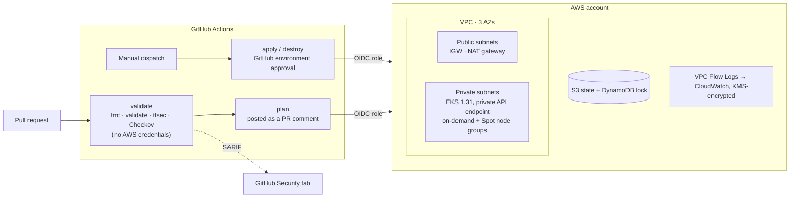

# EKS from a Pull Request: Terraform + GitHub Actions (OIDC)

[](https://github.com/abdihakim-said/EKS-Terraform-GitHub-Actions/actions/workflows/terraform.yml)

Modular Terraform for a private Amazon EKS cluster, deployed from GitHub Actions with short-lived OIDC credentials, scanned by tfsec and Checkov on every pull request, and parameterised for dev, staging and prod.

> **Hands-on build, not client work.** Built and run in my own AWS account to practise the pattern; no production workload ran on it and no business metrics are claimed. Starting point: [AmanPathak-DevOps/EKS-Terraform-GitHub-Actions](https://github.com/AmanPathak-DevOps/EKS-Terraform-GitHub-Actions). My changes are listed [below](#what-i-changed-from-the-starting-point). Write-up on [Medium](https://medium.com/@said-devops).

## Architecture



## What it builds

| Area | Detail |
|---|---|
| Network | VPC across 3 AZs, public and private subnets, one NAT gateway, default security group stripped of all rules |
| Cluster | EKS 1.31, API endpoint private only, control-plane security group allows 443 from the VPC CIDR |
| Compute | One on-demand node group plus one Spot node group with a diversified instance list (c5a, m5a, t3a) |
| Add-ons | vpc-cni, coredns, kube-proxy, aws-ebs-csi-driver (versions pinned in the tfvars) |
| Identity | Cluster OIDC provider for IRSA, with an example role scoped to one service account |
| Audit | VPC Flow Logs to CloudWatch, encrypted with a customer-managed KMS key, 365-day retention |
| State | S3 backend with DynamoDB locking; bucket name supplied at `init`, never committed |

Environments differ only in their tfvars:

| | dev | staging | prod |
|---|---|---|---|
| VPC CIDR | 10.16.0.0/16 | 10.17.0.0/16 | 10.18.0.0/16 |
| On-demand nodes (min/max) | 1 / 5 | 2 / 6 | 3 / 10 |
| Spot nodes (min/max) | 1 / 10 | 1 / 10 | 2 / 20 |

## Pipeline

[`.github/workflows/terraform.yml`](.github/workflows/terraform.yml)

| Job | Trigger | What it does |
|---|---|---|
| validate | every PR and push to `main` touching `eks/` or `module/` | `terraform fmt -check`, `init -backend=false`, `validate`, tfsec and Checkov with SARIF upload. Needs no AWS credentials. |
| plan | PR, or manual dispatch with `action=plan` | Assumes the OIDC role, selects the workspace, posts the plan to the PR |
| apply / destroy | manual dispatch only | Runs behind a GitHub environment (`dev`, `staging`, `prod`), so prod can require a reviewer |

No AWS access keys are stored in GitHub. The workflow exchanges its OIDC token for a short-lived role session (`AWS_ROLE_TO_ASSUME`).

## Security scanning

tfsec and Checkov run on every change, and results go to the repository's Security tab. Findings I fixed in code:

- Wildcard `"*"` action removed from the IRSA example policy
- Default VPC security group locked down (no ingress, no egress)
- VPC Flow Logs enabled, with a KMS-encrypted log group and retention set
- Control-plane ingress limited to the VPC CIDR instead of `0.0.0.0/0`

The scanners run with `soft_fail: true`, so they **report but do not block**. On a real team, I would make high-severity findings block the merge, after agreeing which accepted risks to suppress and recording each suppression next to the resource.

## What I changed from the starting point

The original repo had a GitHub Actions workflow authenticated with stored AWS access keys, a single dev environment, no security scanning, and an API security group open to `0.0.0.0/0`. I changed it as follows:

- **Access keys → OIDC.** The workflow assumes a role with a short-lived token; there are no AWS secrets in GitHub.
- **Scanning.** Added tfsec and Checkov with SARIF upload, then fixed the findings listed above, including a `"*"` action in the IRSA example policy.
- **Validation without credentials.** The validate job runs without AWS credentials, so it works on forks.
- **Plan in the PR.** The plan is posted as a PR comment, and apply and destroy sit behind GitHub environments.
- **More environments.** Added staging and prod tfvars with separate CIDR ranges and node sizing.
- **State setup.** Bootstrapped the state bucket and lock table with a script, and moved the bucket name out of git into a partial backend config.
- **Network hardening.** Added VPC Flow Logs with a KMS key, locked down the default security group, and limited control-plane ingress to the VPC CIDR.

## Run it

Prerequisites: AWS CLI with admin access to a **sandbox** account, Terraform ≥ 1.5, kubectl.

```bash
./setup-backend.sh            # S3 bucket + DynamoDB table; writes eks/backend.hcl
./setup-github-oidc.sh        # GitHub OIDC provider + deploy role (see docs/github-oidc.md)

cd eks
terraform init -backend-config=backend.hcl
terraform workspace new dev
terraform plan  -var-file=dev.tfvars
terraform apply -var-file=dev.tfvars

terraform destroy -var-file=dev.tfvars   # NAT gateway and nodes are billable
```

For CI, set the repository secrets `AWS_ROLE_TO_ASSUME` and `TF_STATE_BUCKET`, and create GitHub environments named `dev`, `staging` and `prod`.

Because the API endpoint is private, `kubectl` only works from inside the VPC (for example via a bastion host, SSM or a VPN), not from a laptop on the internet.

## Known limitations

These are the trade-offs I'd raise in a design review:

- **One NAT gateway.** If its AZ fails, the private subnets lose egress. Production would use one NAT gateway per AZ.
- **Scanners don't block.** See [Security scanning](#security-scanning).
- **Broad CI trust.** The deploy role trusts `repo:<owner>/<repo>:*`. It should be narrowed to `main` and the protected environments.
- **Legacy cluster access.** The cluster uses `CONFIG_MAP` authentication; EKS access entries are the current approach.
- **No in-cluster add-ons.** There is no Cluster Autoscaler, Karpenter, ingress controller or GitOps; this repo stops at the cluster.

## Repository layout

```
eks/                 root module: backend, provider, per-environment tfvars, outputs
module/              VPC, IAM, EKS, node groups, add-ons
.github/workflows/   validate → plan → apply/destroy
setup-backend.sh     state bucket and lock table
setup-github-oidc.sh GitHub OIDC provider and deploy role
quick-start.sh       interactive wrapper around the steps above
docs/github-oidc.md  OIDC setup walkthrough
```

## Licence

Apache 2.0, inherited from the starting point. See [LICENSE](LICENSE).
